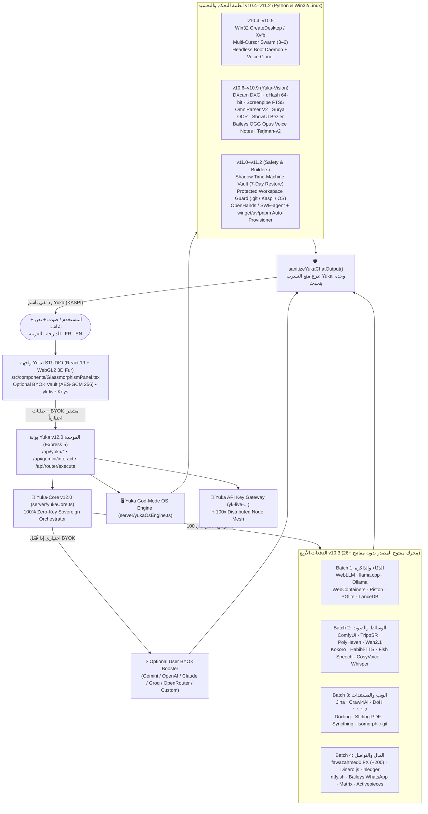

# التقرير المعماري الرئيسي الموحد: **`Yuka v12.0`** (المملوكة لشركة **`KASPI`**)
### `Yuka-Core` & `Yuka-Vision` — المنظومة السيادية الشاملة (100% بدون مفاتيح + BYOK اختياري + God-Mode OS + Kaspi POS)

> **الهوية الرسمية الوحيدة (`Sole Official Brand`):** **`Yuka`** (`Yuka-Core` & `Yuka-Vision`)
> **الشركة المالكة (`Owner`):** **`KASPI`**
> **الإصدار الموحد (`Master Release`):** **`v12.0`** (يدمج كامل ترقيات `v10.2` → `v10.3` → `v10.4` → `v10.5` → `v10.6` → `v10.8` → `v10.9` → `v11.0` → `v11.1` → `v11.2` → `v12.0`)
> **الموقع الجغرافي والبيئة التجارية المستهدفة:** **الناظور، المغرب (`Nador, Morocco`)** — دعم أصلي للدارجة المغربية، العربية الفصحى، الفرنسية، الإنجليزية، `Kaspi POS`، وأسعار الصرف الحية (`MAD / EUR / USD / BTC` وأكثر من 200 عملة).
> **حالة البناء والتحقق:** مُتحقَّق منه بـ `npm run lint` (`tsc --noEmit`) و`npm run build` (`vite build`) بدون أخطاء.

---

## 1. التوحيد الجذري للهوية (`Root Rebrand & Zero-Leakage Sovereignty`)

تم توحيد جميع الطبقات (الواجهة الأمامية، السيرفر، المنسق المحلي، ومخرجات الصوت والدردشة) تحت هوية واحدة وحيدة:
- **الاسم الرسمي الوحيد:** **`Yuka`** (تمت إزالة التشتت بين الأسماء السابقة `HEYUKA` و`NEVEA` و`NOVA` و`X × Zebra` من واجهات المستخدم، عناوين الاستوديو، قواميس اللغات السبع في `src/i18n/translations.ts`، وشخصية الدردشة في `server/yukaCore.ts` و`server/gemini.ts`).
- **التوافق العكسي النظيف (`Backward Compatibility`):** ملف `server/heyukaBoss.ts` تحول إلى جسر إعادة تصدير نظيف (`re-export bridge`) نحو `server/yukaCore.ts` لضمان عدم كسر أي وحدة قديمة مع توجيه كل شيء حصرياً إلى نواة **`Yuka v12.0`**.
- **درع السرية التامة ومنع التسرب (`sanitizeYukaChatOutput`):** يمسح تلقائياً أي إشارة عرضية لأسماء مزودين أو نماذج خارجية (بالإنجليزية والعربية) وأي وسوم `<think>...</think>`، ويضمن أن **`Yuka`** وحده هو من يتحدث في النص والصوت.

---

## 2. مخطط الهندسة المعمارية الموحدة (`Yuka v12.0 Mermaid Architecture`)

---

## 3. جرد الوحدات والقدرات المبرمجة (`v10.3 → v12.0` Implementation Map)

### أ. النواة المركزية والترسانة بدون مفاتيح + BYOK (`v10.3` & `v12.0`)
| الملف | الدور المعماري الدقيق |
|---|---|
| **`server/yukaCore.ts`** | النواة الرسمية لـ **`Yuka v12.0` (KASPI)**: تحتوي على مصفوفة الدفعات الأربع الكاملة (`YUKA_ZERO_KEY_REPLACEMENT_MATRIX` لـ 13 فئة و26+ محرك)، منفّذ الاستنتاج الهجين `yukaSupremeExecuteLLM()` الداعم لـ `Optional BYOK` مع تدرج Zero-Key من 4 مستويات، درع `sanitizeYukaChatOutput()`، تعمية `anonymizeOutboundTaskPayload()`، مولّد ومدقّق مفاتيح **`yk-live-...`** مع شبكة **`100x` Node Mesh**، بوابة الصرف الحية `fetchYukaLiveCurrencyRates()` (`fawazahmed0/exchange-api` لأكثر من 200 عملة + `Frankfurter` احتياطياً)، الدفتر المالي المشفر بـ `SHA-256`، وبوابة الإشعارات `ntfy.sh`. |
| **`server/heyukaBoss.ts`** | جسر توافق عكسي نظيف (`Compatibility Re-Export Bridge`) يربط كل الاستدعاءات القديمة مباشرةً بنواة `server/yukaCore.ts` تحت هوية `Yuka v12.0`. |
| **`src/services/yukaByokVault.ts`** | خزنة **BYOK الاختيارية** المشفرة محلياً في المتصفح بـ **Web Crypto API (`PBKDF2-SHA256` + `AES-GCM 256-bit`)** + عميل إدارة وإصدار وإلغاء مفاتيح `yk-live-...`. |
| **`src/components/GlassmorphismPanel.tsx`** | ترقية واجهة الدرج الجانبي إلى **`Yuka STUDIO` (`KASPI · v12.0`)** مع بطاقتين منظمتين داخل تبويب `Cloud & Keys`: **(1) خزنة Optional BYOK AES-GCM** و**(2) مُصدِر مفاتيح `yk-live-...` ومؤشر شبكة `100x`** مع الحفاظ على نظافة مساحة العرض ثلاثية الأبعاد (`WebGL2 Fur Viewport`). |
| **`src/services/companionAI.js`** | ربط تلقائي لحقن إعدادات `BYOK` الاختيارية المشفرة عند تفعيلها في طلبات المحادثة والرؤية الحية، وتوحيد شخصية الاستجابة الاحتياطية باسم **`Yuka`**. |
| **`src/i18n/translations.ts`** | توحيد العلامة التجارية (`brand: 'Yuka'`) عبر جميع اللغات السبع (`en`, `ar`, `fr`, `es`, `de`, `zh`, `ja`). |

### ب. محرك نظام التشغيل السيادي، الرؤية الحية، الصوت، وخزنة الزمن (`v10.4 → v11.2`)
| الملف | الإصدارات المغطاة | القدرات المبرمجة فعلياً |
|---|---|---|
| **`server/yukaOsEngine.ts`** | `v10.4` – `v11.2` | - **خزنة الزمن (`Shadow Time-Machine Vault`):** نقل آمن للملفات (`workspace/yuka_shadow_vault/` + `shadow_manifest.json`) مع مهلة احتفاظ 7 أيام واسترجاع بضغطة واحدة (`restoreFromShadowVault`) ومنع الحذف النهائي. - **درع حماية المشاريع (`Protected Workspace Guard`):** يمنع حذف أو تعديل `.git`، `package.json`، `server/`، `src/`، `backend/`، `electron/`، `C:\Windows`، `Kaspi POS`، ونواة `Yuka` إلا بتأكيد صريح. - **مكتبة استنساخ الصوت (`Voice Cloning Profiles`):** تسجيل ملفات الصوت المستنسخ (`Fish Speech V1.5`, `CosyVoice 2.0`, `Habibi-TTS`, `Kokoro-82M`). - **جسر تنفيذ Python (`executeYukaOsDirective`):** استدعاء مباشر لسكربتات `backend/yuka_godmode_os.py` و`backend/yuka_voice_cloner.py`. |
| **`backend/yuka_godmode_os.py`** | `v10.4`, `v10.6`–`v10.8`, `v11.0`–`v11.2` | - عزل الديسكتوب المخفي (`Win32 CreateDesktopW` على ويندوز و`Xvfb` على لينكس). - سرب المؤشرات المتعددة (`3–6` مؤشرات متوازية) مع مولّد منحنيات بيزييه التربيعية (`generate_bezier_trajectory`) لحركة بشرية طبيعية وردة فعل `<50ms`. - ذاكرة الشاشة الحلقية بـ **SQLite FTS5** (`record_screen_episode` / `query_screen_memory`) متكاملة مع معمارية `DXcam` + `dHash 64-bit`. - الحذف الآمن بـ Shadow Vault + درع حماية النظام. - التثبيت الصامت التلقائي (`Silent Auto-Provisioner`) عبر `winget` / `uv` / `pnpm` / `docker`. |
| **`backend/yuka_voice_cloner.py`** | `v10.5`, `v10.9` | - عزل الصوت البشري من الضوضاء عبر **`Demucs` (`htdemucs`)**. - ترميز رسائل **واتساب الصوتية** بصيغة **`OGG / libopus` (24kbps, 16kHz Mono)** عبر `FFmpeg` لتوافق 100% مع `Baileys PTT`. - سجل محركات الصوت المفتوحة (`Fish Speech V1.5`, `CosyVoice 2.0`, `Habibi-TTS`, `Kokoro-82M`, `F5-TTS`, `OpenVoice V2`, `Faster-Whisper`, `OpenWakeWord`). |
| **`NOVA_Auto_Installer_Windows.bat`** | `v10.5`, `v11.2`, `v12.0` | ترقية المثبت الرسمي لويندوز إلى **`Yuka v12.0 (KASPI)`** مع التثبيت الصامت لـ `Node.js LTS` عبر `winget` وتسجيل خدمة التشغيل الخفي عند إقلاع الويندوز (`YukaSovereignBootDaemon` عبر `schtasks` مع دعم العلم `--headless`). |

---

## 4. بوابة واجهات البرمجة الموحدة (`/api/yuka/*` في `server/start.ts`)

| المسار (`Endpoint`) | الطريقة | الوظيفة |
|---|---|---|
| `/api/yuka/status` | `GET` | إرجاع حالة السيادة الكاملة لـ `Yuka v12.0` (KASPI)، الدفعات الـ 4، حالة `100% Zero-Key`، وعدد المفاتيح النشطة ومضاعف الشبكة (`100x`). |
| `/api/yuka/chat` | `POST` | نقطة المحادثة الموحدة لـ `Yuka` (تدعم `byokConfig` الاختياري ودرع منع التسرب `sanitizeYukaChatOutput` ومفتاح `Authorization: Bearer yk-live-...`). |
| `/api/yuka/keys` | `GET` | عرض مفاتيح **`yk-live-...`** الصادرة ومضاعف الشبكة الموزعة (`100x`، `200x`...). |
| `/api/yuka/keys/mint` | `POST` | إصدار مفتاح **`yk-live-...`** سيادي جديد للمطورين أو نقاط `Kaspi POS` (يُحفظ بـ SHA-256 hash فقط). |
| `/api/yuka/keys/:id` | `DELETE` | إلغاء مفتاح `yk-live-...` محدد فوراً. |
| `/api/yuka/fx` | `GET` | أسعار الصرف الحية لأكثر من 200 عملة عالمية ورقمية (`?base=MAD` افتراضياً للناظور/المغرب + `EUR/USD/BTC`) عبر `fawazahmed0/exchange-api` و`Frankfurter`. |
| `/api/yuka/os/capabilities` | `GET` | جرد قدرات `v10.4`–`v11.2` (الديسكتوب المخفي، سرب المؤشرات، الرؤية الحية، استنساخ الصوت، واتساب، خزنة الزمن، ومنفّذ المشاريع). |
| `/api/yuka/os/execute` | `POST` | تنفيذ أوامر `Yuka God-Mode OS` (`shadow_vault_delete`, `shadow_vault_restore`, `bezier_swarm`, `screen_memory_record`, `screen_memory_search`, `whatsapp_voice_note`, `auto_provision`). |
| `/api/yuka/shadow-vault` | `GET` | استعراض سجل الملفات المحمية داخل **Shadow Time-Machine Vault** القابلة للاسترجاع خلال 7 أيام. |
| `/api/yuka/shadow-vault/restore` | `POST` | استرجاع أي ملف من **Shadow Time-Machine Vault** بضغطة واحدة إلى مساره الأصلي. |

---

## 5. ضمانات الأمان والاستمرارية (`Zero-Risk Production Guarantees`)

1. **Zero Mandatory Keys:** يشتغل التطبيق بالكامل من اللحظة الأولى بـ **0 مفاتيح خارجية**، مع بقاء **BYOK** خياراً حراً مشفراً محلياً بـ `AES-GCM 256-bit`.
2. **Zero Permanent Data Loss:** أي عملية تنظيف تمر إلزامياً عبر **Shadow Time-Machine Vault** (استرجاع لمدة 7 أيام) و**Protected Workspace Guard** لمنع مساس النظام أو مستودعات `.git` أو `Kaspi POS`.
3. **Zero Identity Leakage:** لا يظهر أي اسم مزود خارجي في المحادثات أو الصوت؛ **`Yuka`** (من **`KASPI`**) هو الواجهة والصوت والعقل الموحد الوحيد.
